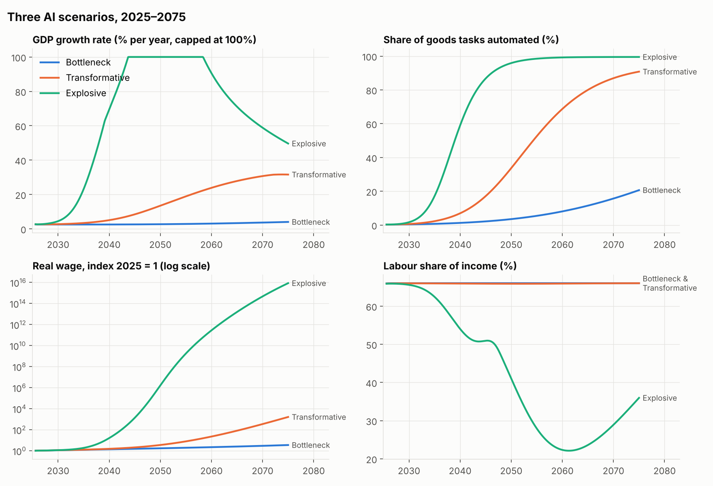
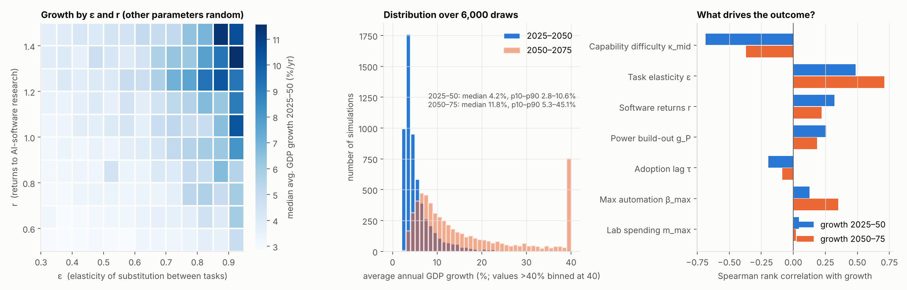

# ENDO_AI v1.0 — An endogenous growth model with AI

**Version:** 1.0 (rule-based closure)
**Code:** [`../src/ai_growth_model.py`](../src/ai_growth_model.py), [`../src/run_and_plot.py`](../src/run_and_plot.py)
**Results:** [`../output/`](../output/)

---

## Contents

1. [Purpose and overview](#1-purpose-and-overview)
2. [Relation to the standard endogenous growth model](#2-relation-to-the-standard-endogenous-growth-model)
3. [Model structure](#3-model-structure)
   1. [State variables and time](#31-state-variables-and-time)
   2. [Compute, software and energy](#32-compute-software-and-energy)
   3. [AI capability and automation](#33-ai-capability-and-automation)
   4. [Goods production](#34-goods-production)
   5. [Factor prices](#35-factor-prices)
   6. [Research sectors](#36-research-sectors)
   7. [Investment, hardware and power](#37-investment-hardware-and-power)
   8. [Capital, population and labour](#38-capital-population-and-labour)
4. [Closure of Version 1](#4-closure-of-version-1)
5. [Calibration and initial conditions](#5-calibration-and-initial-conditions)
6. [Parameter table](#6-parameter-table)
7. [Scenarios](#7-scenarios)
8. [Monte Carlo design](#8-monte-carlo-design)
9. [Results](#9-results)
10. [Interpretation](#10-interpretation)
11. [Limitations and roadmap](#11-limitations-and-roadmap)
12. [Numerical implementation](#12-numerical-implementation)
13. [References](#13-references)

---

## 1. Purpose and overview

The model simulates the world economy from 2025 to 2075 in a world where
artificial intelligence (AI) increasingly (i) takes over production tasks,
(ii) takes over research tasks, and (iii) improves its own software. It is
designed to answer three questions:

* **How fast can output grow** once AI is able to substitute for human labour
  in a growing share of tasks, including research?
* **What limits that growth**: the tasks that stay with humans (Baumol
  bottlenecks), diminishing returns to research, or physical constraints
  (chips, power, capital construction)?
* **What happens to wages and the labour share** along the way?

The model has a semi-endogenous core of the Jones (1995) type. It adds a
task-based production structure (Zeira 1998; Acemoglu & Restrepo 2018),
AI-automated research (Aghion, Jones & Jones 2019), a separate AI-software
sector with recursive self-improvement (Davidson 2021; Erdil & Besiroglu 2023),
and physical compute and energy constraints.

Version 1 closes the model with **behavioural rules**: a fixed saving rate,
fixed shares for research labour and compute uses, and an investment split
that responds to returns. It is not an intertemporal equilibrium; see
[Section 11](#11-limitations-and-roadmap).

---

## 2. Relation to the standard endogenous growth model

The standard semi-endogenous model is

$$
Y = A^{\sigma} K^{\alpha} L_Y^{1-\alpha}, \qquad
\dot A = \theta\, L_A^{\lambda} A^{\phi}, \qquad
L_Y + L_A = L .
$$

On a balanced growth path, $g_A = \lambda n / (1-\phi)$, where $n$ is population
growth. **Research input is capped by the number of people.** AI removes this
cap. Something else must then determine growth, and this model makes those
"something elses" explicit.

| Feature | Standard model | ENDO_AI v1.0 |
|---|---|---|
| Production | Cobb-Douglas, fixed labour share | Task-based CES, endogenous automation share, complements ($\varepsilon<1$) |
| Research input | Humans only | CES of humans and AI researchers, partly automatable |
| Recursion | None | AI improves its own software $S$ |
| Capital | One stock $K$ | Physical capital $K$, compute hardware $H$, power capacity $P$ |
| Physical limits | None | Power build-out rate, capital construction rate, software-efficiency ceiling |
| Diffusion | Instantaneous | Adoption lags $\tau$, $\tau_R$ and a cost gate |
| Distribution | Fixed shares | Wage and labour share are outcomes |
| Uncertainty | Deterministic | Monte Carlo over 8 key parameters |

---

## 3. Model structure

### 3.1 State variables and time

Time is continuous and is discretised with step $\Delta t = 0.1$ years.

| Symbol | Code | Meaning | Units |
|---|---|---|---|
| $K$ | `K` | Physical capital | $ trillion (2025 GDP = 100) |
| $H$ | `H` | Installed AI hardware | FLOP/s, normalised $H_0=1$ |
| $P$ | `Pw` | Power / datacentre capacity for AI | 2025 FLOP/s-equivalents |
| $S$ | `lnS` (log) | AI software / algorithmic efficiency | index, $S_0=1$ |
| $a$ | `a` | General technology (TFP) index | $A = A_0 a$, $a_0=1$ |
| $Q$ | `Q` | Hardware price-performance | FLOP/s per $ |
| $\eta$ | `eta` | Energy efficiency of compute | FLOP/s per unit of power, $\eta_0=1$ |
| $\tilde\beta$ | `bt` | Deployed share of goods tasks automated | [0, 1] |
| $\tilde\beta_R$ | `btR` | Deployed share of research tasks automated | [0, 1] |
| $\mathcal{C}$ | `cumCT` | Cumulative effective training compute | normalised |
| $x_H$ | `xH` | Share of market investment going to AI compute | [0, 1] |
| $L$ | `L` | Population / labour force | $L_0 = 1$ |

### 3.2 Compute, software and energy

Hardware can only run if it is powered. The **usable** hardware stock is

$$
H^{use}_t = \min\big(H_t,\ \eta_t P_t\big).
$$

**Effective compute** is usable hardware multiplied by software efficiency,
$S_t H^{use}_t$. Effective compute is split between fixed uses:

| Use | Share | Symbol |
|---|---|---|
| Training of frontier models | $u_T = 0.30$ | $C_T = u_T S H^{use}$ |
| Inference in goods production | $u_Y = 0.40$ | $C_Y = u_Y S H^{use}$ |
| Inference for general research | $u_{RA} = 0.10$ | $C_{RA}$ |
| Inference for AI-software research | $u_{RS} = 0.15$ | $C_{RS}$ |
| Experiments (measured in raw hardware) | $u_{exp} = 0.05$ | $H_{exp} = u_{exp} H^{use}$ |

AI input is measured in **worker-equivalents**. In goods production,

$$
X_t = \frac{S_t\, u_Y\, H^{use}_t}{c},
$$

where $c$ is the compute needed to replace one worker on an automated task.
AI researchers need $c_R = 30$ times more compute per worker-equivalent,
because research tasks are long-horizon:

$$
X_{RA} = \frac{S\, u_{RA}\, H^{use}}{c\, c_R}, \qquad
X_{RS} = \frac{S\, u_{RS}\, H^{use}}{c\, c_R}.
$$

### 3.3 AI capability and automation

**Capability** is measured by the log of cumulative effective training compute,
normalised so that $\kappa_{2025} = 0$:

$$
\dot{\mathcal{C}} = \frac{C_T}{\bar C_T}, \qquad \kappa_t = \ln \mathcal{C}_t,
$$

with $\bar C_T$ = three years of 2025 training compute, so $\mathcal{C}_{2025}=1$.

**Automatable task shares** follow logistic curves in capability:

$$
\beta(\kappa) = \frac{\beta_{\max}}{1 + \exp\!\big(-(\kappa - \bar\kappa)/w\big)},
\qquad
\beta_R(\kappa) = \frac{\beta_{R,\max}}{1 + \exp\!\big(-(\kappa - \bar\kappa - \Delta_R)/w_R\big)} .
$$

* $\bar\kappa$ (`kappa_mid`) is **capability difficulty**: how many log-units
  of effective training compute beyond 2025 are needed to automate half of
  $\beta_{\max}$.
* $\Delta_R$ (`kappaR_extra` = 3) makes research somewhat harder to automate than
  goods production.
* The widths $w, w_R$ are pinned down so that $\beta(0) = \beta_0$ and
  $\beta_R(0) = \beta_{R,0}$:
  $w = \bar\kappa / \ln(\beta_{\max}/\beta_0 - 1)$.

**Deployment** lags behind what is technically possible. In goods production,
firms adopt automation only where AI is cheaper than labour. Let $p_X$ be the
user cost of one AI worker-equivalent and $w$ the wage
([Section 3.5](#35-factor-prices)). The adoption gate is

$$
G_t = \frac{1}{1 + \exp\!\big(-\gamma_G \ln(w_t/p_{X,t})\big)}, \qquad \gamma_G = 2 ,
$$

and deployment adjusts towards the target with lag $\tau$:

$$
\dot{\tilde\beta} = \frac{\max\!\big(\beta(\kappa)\,G,\ \beta_0\big) - \tilde\beta}{\tau},
\qquad
\dot{\tilde\beta}_R = \frac{\beta_R(\kappa) - \tilde\beta_R}{\tau_R}.
$$

Research labs adopt faster ($\tau_R = 3$) and are not cost-gated, because labs
use their own compute.

### 3.4 Goods production

Output is Cobb-Douglas in physical capital and a CES **task aggregate** $Z$:

$$
Y = A\, K^{\alpha}\, Z^{1-\alpha},
$$

$$
Z = \Big[\tilde\beta^{1/\varepsilon} X^{\rho} + (1-\tilde\beta)^{1/\varepsilon} L_Y^{\rho}\Big]^{1/\rho},
\qquad \rho = \frac{\varepsilon-1}{\varepsilon}.
$$

This is the reduced form of a task model. Tasks on $[0,1]$ are combined with
elasticity $\varepsilon$. A share $\tilde\beta$ of tasks is done by AI, the rest
by humans, and within each group inputs are spread evenly.

**Why $\varepsilon$ is so important.** With $\varepsilon<1$ ($\rho<0$), tasks are
complements. If $X \to \infty$ while $\tilde\beta < 1$ stays fixed, then

$$
Z \;\to\; (1-\tilde\beta)^{1/(\varepsilon-1)} L_Y ,
$$

so output is bounded by the human-performed tasks. This is the **Baumol
bottleneck**. Unbounded growth from AI alone requires $\tilde\beta \to 1$ or
$\varepsilon \ge 1$. The bound grows quickly as $\varepsilon \to 1$. For example,
with $\tilde\beta = 0.9$ and $\varepsilon = 0.5$ it is $100 L_Y$; with
$\tilde\beta = 0.995$ and $\varepsilon = 0.8$ it is about $3\times10^{11} L_Y$.

### 3.5 Factor prices

Let $B = \tilde\beta^{1/\varepsilon} X^{\rho} + (1-\tilde\beta)^{1/\varepsilon} L_Y^{\rho}$.
The marginal products are

$$
w = \frac{\partial Y}{\partial L_Y} = (1-\alpha)\,Y\,\frac{(1-\tilde\beta)^{1/\varepsilon} L_Y^{\rho-1}}{B},
\qquad
MP_X = (1-\alpha)\,Y\,\frac{\tilde\beta^{1/\varepsilon} X^{\rho-1}}{B},
\qquad
MP_K = \alpha \frac{Y}{K}.
$$

All human labour, including researchers, is paid the wage $w$. The **labour
share** is $w L / Y$.

The **price of one unit of new usable compute** is chips plus the power to run
them:

$$
\pi_t = \frac{1}{Q_t} + \frac{p_P}{\eta_t},
$$

with $p_P$ the (constant) price of one unit of power capacity.

The **net return on compute** assumes all uses rent compute at its value in
goods production:

$$
r_H = MP_X \cdot \frac{S}{c}\cdot\frac{1}{\pi} - \delta_H, \qquad r_K = MP_K - \delta_K .
$$

The **user cost of one AI worker-equivalent**, used in the adoption gate, is

$$
p_X = \big(\max(r_K, 0.01) + \delta_H\big)\,\frac{\pi\, c}{S}.
$$

### 3.6 Research sectors

There are two research sectors. In both, research input is a CES of human
researchers and AI researchers with the same elasticity $\varepsilon$ as goods
production:

$$
R_j = \Big[\tilde\beta_R^{1/\varepsilon} X_{Rj}^{\rho} + (1-\tilde\beta_R)^{1/\varepsilon} L_j^{\rho}\Big]^{1/\rho},
\qquad j \in \{A, S\}.
$$

**General technology (TFP):**

$$
\frac{\dot a}{a} = \theta_A\, a^{\phi_A - 1} \left(\frac{R_A}{R_{A,0}}\right)^{\lambda_A},
$$

with $\theta_A = 0.012$ (1.2 % TFP growth in 2025), $\lambda_A = 0.5$ and $\phi_A = 0.5$.
The implied returns to research are $r_A = \lambda_A/(1-\phi_A) = 1$.

**AI software (algorithmic efficiency):**

$$
\frac{\dot S}{S} = \theta_S\, S^{\phi_S - 1}\left(\frac{R_S}{R_{S,0}}\right)^{\lambda_S}
\left(\frac{H_{exp}}{H_{exp,0}}\right)^{\gamma}
\left(1 - \frac{\ln S}{\ln S_{\max}}\right).
$$

* $\theta_S = 0.9$ means efficiency grows about 2.5× per year in 2025, in line
  with estimates of algorithmic progress in language models (Ho et al. 2024).
* **The key parameter is the return to software research**
  $r = \lambda_S / (1 - \phi_S)$. The code takes $r$ as input and sets
  $\phi_S = 1 - \lambda_S / r$.
* **Experiment compute** $H_{exp}$ enters with elasticity $\gamma = 0.3$. It is
  measured in raw hardware, not software-adjusted compute, so hardware is a
  bottleneck for software progress even when AI researchers are abundant.
* The last factor is a **soft ceiling**. Algorithmic efficiency cannot improve
  by more than $S_{\max} = 10^6$ relative to 2025.

**Why $r$ matters.** Once AI does most software research,
$R_S \propto X_{RS} \propto S H$. Holding $H$ fixed,

$$
\frac{\dot S}{S} \propto S^{\phi_S - 1 + \lambda_S} = S^{\lambda_S (1 - 1/r)} .
$$

If $r > 1$ the growth rate of $S$ *rises* with $S$, which is explosive (a
"software intelligence explosion"). If $r < 1$ it falls. With $\varepsilon < 1$
and $\tilde\beta_R < 1$, human AI researchers $L_S$ remain a bottleneck.
Human AI-research labour grows at $g_{LS} = 8\%$ per year until it reaches 5×
its 2025 level.

### 3.7 Investment, hardware and power

Gross saving is a fixed share of output, $sY$, with $s=0.25$. It is used in two
steps.

**Step 1: frontier-lab spending.** Labs buy compute for training, research and
experiments as a share of GDP that rises along a logistic path:

$$
I_{lab} = m_t Y_t, \qquad
m_t = m_0 + \frac{m_{\max} - m_0}{1 + \exp(-(t - t_m)/w_m)},
$$

with $m_0 = 0.4\%$ (about \$400 bn in 2025), $t_m = 2032$ and $w_m = 3$.
This spending is driven by expectations of future capability, which a myopic
return rule cannot capture. Version 2 will derive it.

**Step 2: the market split.** The rest, $I_{mkt} = sY - I_{lab}$, is split
between physical capital and inference compute. The target share for compute
is a softmax in returns, capped at $\bar x_H = 0.6$:

$$
x_H^{*} = \min\!\left(\frac{1}{1 + (r_K / r_H)^{\zeta}},\ \bar x_H\right),
\qquad
\dot x_H = \frac{x_H^{*} - x_H}{\tau_I},
$$

with $\zeta = 3$ and $\tau_I = 2$ years (investment adjustment lag).

**Buying compute.** Desired spending on compute is $I_C = I_{lab} + x_H I_{mkt}$.
Chips and power are bought together at price $\pi$, so unconstrained new
usable compute is $\Delta H = I_C \Delta t / \pi$. The power needed is

$$
P^{need}_{t+\Delta t} = \frac{(1-\delta_H\Delta t) H_t + \Delta H}{\eta_{t+\Delta t}} .
$$

**Power build-out is rate-limited.** Capacity cannot grow faster than $g_P$ per
year (grid connections, generation, permitting):

$$
P^{\max}_{t+\Delta t} = (1-\delta_P\Delta t)\,P_t\, e^{g_P \Delta t}.
$$

If $P^{need} > P^{\max}$, chip purchases are reduced to what can be powered,
and the unspent money flows into physical capital. Investment in power is
$I_P = p_P\,\max(P_{t+\Delta t} - (1-\delta_P\Delta t)P_t,\,0)/\Delta t$.
Investment in chips is $I_{chip} = \Delta H / (Q\,\Delta t)$, and
$I_K = sY - I_{chip} - I_P$.

**Hardware price-performance** improves through an exogenous trend plus
learning-by-doing (Wright's law) on cumulative chip spending $\mathcal{I}$:

$$
\frac{\dot Q}{Q} = g_Q + b\,\frac{I_{chip}}{\mathcal{I}}, \qquad \dot{\mathcal{I}} = I_{chip},
$$

with $g_Q = 0.25$ (FLOP/s per $ doubles about every 2.8 years) and $b = 0.1$.
Energy efficiency grows exogenously, $\dot\eta/\eta = g_\eta = 0.12$.

Stock dynamics:

$$
\dot H = \frac{\Delta H}{\Delta t} - \delta_H H, \qquad
\dot P = \text{(as above)} .
$$

### 3.8 Capital, population and labour

$$
\dot K = \min\!\Big(I_K - \delta_K K,\ \ g_K^{\max} K\Big),
$$

with $g_K^{\max} = 0.30$, a construction limit on how fast physical capital can
grow. Population grows at $n = 0.4\%$. Labour is split between goods
production $L_Y$, general research $L_A = 0.015\,L$ and AI-software research
$L_S$.

---

## 4. Closure of Version 1

| Decision | Version 1 rule | Planned for Version 2 |
|---|---|---|
| Consumption vs saving | Fixed $s = 0.25$ | Ramsey households, Euler equation |
| Frontier-lab compute spending | Exogenous logistic GDP share | Forward-looking value of capability |
| Market investment $K$ vs $H$ | Softmax on current net returns, partial adjustment | No-arbitrage between assets |
| Labour across sectors | Fixed shares (with growth of $L_S$) | Wage equalisation with shadow value of ideas |
| Compute across uses | Fixed shares $u_\cdot$ | Equalised marginal values |
| Automation adoption | Capability × cost gate, lag $\tau$ | Endogenous adoption cost |

---

## 5. Calibration and initial conditions

* **Units.** World GDP in 2025 is $Y_0 = 100$ (roughly \$ trillion). $L_0 = 1$, $K_0 = 3Y_0$.
* **Initial automation.** $\tilde\beta_0 = \tilde\beta_{R,0} = 0.3\%$ of tasks.
* **AI input in 2025.** $X_0 = \beta_0 L_{Y,0}$: AI works its automated tasks at the
  same intensity as humans work theirs. This pins down $c = u_Y H_0 / X_0$.
* **Hardware.** The 2025 AI hardware stock is worth $V_{H0} = \$1$ trillion, so
  $Q_0 = H_0 / V_{H0}$. Power and datacentre cost is $0.5\times$ chip cost per
  FLOP/s in 2025, and 2025 power capacity can run $2\times H_0$.
* **TFP level.** $A_0$ is chosen so that $Y_0 = 100$.
* **Research normalisations.** $R_{A,0}$, $R_{S,0}$ and $H_{exp,0}$ are 2025
  values, so $\theta_A$ and $\theta_S$ are the 2025 growth rates of $a$ and $S$.

Empirical anchors (all approximate):

| Quantity | Anchor | Source |
|---|---|---|
| Frontier training compute growth | ~4–5× per year recently | Epoch AI |
| Algorithmic efficiency (LLMs) | Compute for fixed performance halves every ~8 months | Ho et al. (2024) |
| Hardware price-performance | Doubles every ~2–3 years | Epoch AI (Hobbhahn & Besiroglu) |
| TFP growth | ~1–1.5 % per year | Standard growth accounting |
| Adoption lag | 5–15 years | Historical general-purpose technologies |

---

## 6. Parameter table

| Parameter | Code | Default | Meaning |
|---|---|---|---|
| $\alpha$ | `alpha` | 0.35 | Capital share |
| $\varepsilon$ | `eps` | 0.6 | Elasticity of substitution between tasks |
| $s$ | `s` | 0.25 | Gross saving rate |
| $\delta_K$ | `delta_K` | 0.05 | Capital depreciation |
| $g_K^{\max}$ | `gK_max` | 0.30 | Max capital growth (construction limit) |
| $n$ | `n` | 0.004 | Population growth |
| $\beta_0$, $\beta_{R,0}$ | `beta0`, `betaR0` | 0.003 | Initial automated shares |
| $\beta_{\max}$, $\beta_{R,\max}$ | `beta_max`, `betaR_max` | 0.95 | Automation ceilings |
| $\bar\kappa$ | `kappa_mid` | 12 | Capability difficulty (log-units) |
| $\Delta_R$ | `kappaR_extra` | 3 | Extra difficulty for research tasks |
| $\tau$, $\tau_R$ | `tau`, `tau_R` | 8, 3 | Adoption lags (years) |
| $\gamma_G$ | `gate_slope` | 2 | Sharpness of cost gate |
| $V_{H0}$ | `V_H0` | 1.0 | 2025 AI hardware value (\$T) |
| $\delta_H$ | `delta_H` | 0.20 | Hardware depreciation |
| $g_Q$ | `g_Q` | 0.25 | Exogenous price-performance growth |
| $b$ | `wright_b` | 0.10 | Learning-by-doing elasticity |
| $\zeta$ | `zeta` | 3 | Sensitivity of investment split |
| $\tau_I$ | `tau_I` | 2 | Investment adjustment lag |
| $\bar x_H$ | `xH_max` | 0.6 | Cap on market compute share |
| $m_0$, $m_{\max}$ | `m0`, `m_max` | 0.004, 0.03 | Lab spending share of GDP |
| $t_m$, $w_m$ | `m_mid`, `m_w` | 2032, 3 | Timing of lab spending ramp |
| $g_{LS}$ | `g_LS` | 0.08 | Growth of human AI researchers (capped at 5×) |
| $u_T,u_Y,u_{RA},u_{RS},u_{exp}$ | `u_*` | 0.30, 0.40, 0.10, 0.15, 0.05 | Compute use shares |
| $c_R$ | `c_R` | 30 | Compute premium for AI researchers |
| $g_\eta$ | `g_eta` | 0.12 | Energy-efficiency growth |
| $g_P$ | `g_P` | 0.15 | Max power build-out rate |
| $p_P\eta_0 Q_0$ | `power_cost` | 0.5 | Power cost relative to chips (2025) |
| $\delta_P$ | `delta_P` | 0.04 | Power capacity depreciation |
| $\theta_A,\lambda_A,\phi_A$ | `th_A`, `lam_A`, `phi_A` | 0.012, 0.5, 0.5 | TFP research |
| $L_A/L$ | `LA_share` | 0.015 | General research labour |
| $\theta_S,\lambda_S$ | `th_S`, `lam_S` | 0.9, 0.6 | Software research |
| $r$ | `r` | 1.0 | Returns to software research |
| $\gamma$ | `gam` | 0.3 | Experiment-compute elasticity |
| $S_{\max}$ | `lnS_max` | $\ln 10^6$ | Software-efficiency ceiling |
| $L_S/L$ | `LS_share` | 0.0005 | Initial AI-research labour |

---

## 7. Scenarios

| Parameter | Bottleneck | Transformative | Explosive |
|---|---|---|---|
| $\varepsilon$ | 0.4 | 0.6 | 0.8 |
| $r$ | 0.7 | 1.0 | 1.4 |
| $\beta_{\max}$ | 0.70 | 0.95 | 0.995 |
| $\beta_{R,\max}$ | 0.60 | 0.95 | 0.995 |
| $\bar\kappa$ | 16 | 12 | 9 |
| $\tau$ | 12 | 7 | 4 |
| $g_P$ | 0.08 | 0.15 | 0.30 |
| $m_{\max}$ | 1.2 % | 3 % | 5 % |

* **Bottleneck:** strong complementarity, diminishing returns to software,
  hard-to-reach capabilities and slow power build-out.
* **Transformative:** near-full automation is eventually possible, $r \approx 1$,
  and power expands at the current fast pace.
* **Explosive:** AI capabilities come quickly, $r > 1$, near-full automation,
  and very fast physical build-out.

---

## 8. Monte Carlo design

6,000 draws from independent uniform distributions (seed 1). All other
parameters stay at their defaults.

| Parameter | Range |
|---|---|
| $\varepsilon$ | [0.30, 0.95] |
| $r$ | [0.5, 1.5] |
| $\beta_{\max} = \beta_{R,\max}$ | [0.60, 0.995] |
| $\tau$ | [3, 15] years |
| $g_P$ | [0.05, 0.30] |
| $\bar\kappa$ | [8, 18] |
| $m_{\max}$ | [1 %, 5 %] |

Outcome measures:

* Average annual GDP growth $\ln(Y_{2050}/Y_{2025})/25$ and $\ln(Y_{2075}/Y_{2050})/25$.
* Labour share in 2050.
* Spearman rank correlation of each parameter with the growth outcomes.

---

## 9. Results

All numbers come from [`../output/summary.txt`](../output/summary.txt). They
can be reproduced with `python src/run_and_plot.py`.

### 9.1 Scenarios



| Scenario | Growth 2030 | Growth 2050 | Growth 2070 | Tasks automated 2050 | Wage index 2050 (2025 = 1) | Labour share 2050 |
|---|---|---|---|---|---|---|
| Bottleneck | 2.5 % | 2.7 % | 3.7 % | 3 % | 1.7 | 66 % |
| Transformative | 2.7 % | 13.5 % | 30.7 % | 34 % | 3.5 | 66 % |
| Explosive | 4.5 % | 165 % | 59 % | 96 % | 1.6 × 10⁶ | 41 % |

### 9.2 Monte Carlo



* **Average growth 2025–2050:** median 4.2 % per year; 5th–95th percentile
  2.7 %–14.6 %. 11 % of draws average more than 10 % per year.
* **Average growth 2050–2075:** median 11.8 %; 5th–95th percentile 4.4 %–60 %.
* **Labour share 2050:** median 66 %; 5th percentile 56 %.

Spearman rank correlation of each parameter with average growth:

| Parameter | 2025–50 | 2050–75 |
|---|---|---|
| Capability difficulty $\bar\kappa$ | −0.68 | −0.37 |
| Task elasticity $\varepsilon$ | +0.49 | +0.71 |
| Software returns $r$ | +0.32 | +0.22 |
| Power build-out $g_P$ | +0.26 | +0.19 |
| Adoption lag $\tau$ | −0.20 | −0.09 |
| Max automation $\beta_{\max}$ | +0.13 | +0.35 |
| Lab spending $m_{\max}$ | +0.04 | +0.02 |

---

## 10. Interpretation

1. **Timing versus ceiling.** Up to 2050, the biggest driver is *how quickly
   capabilities arrive* ($\bar\kappa$). After 2050, the biggest driver is *how
   far automation can push output* ($\varepsilon$, $\beta_{\max}$). Debates
   about AI timelines and debates about AI's economic ceiling are therefore
   largely separate questions.
2. **The Baumol bottleneck protects labour income.** With $\varepsilon<1$, the
   tasks that remain with humans become scarce. Wages then rise roughly in
   proportion to output, and the labour share hardly moves. It falls
   materially only when $\varepsilon$ is high *and* almost all tasks are
   automated (Explosive scenario).
3. **Physical constraints bind early.** In all scenarios, power build-out
   limits compute from the late 2020s onwards. This is why lab spending
   ($m_{\max}$) has almost no effect on growth: beyond the power limit,
   extra money buys chips that cannot be switched on.
4. **Recursion needs $r>1$ *and* automated research.** Software returns matter,
   but less than in pure software-takeoff models, because human researchers and
   raw experiment hardware remain bottlenecks while $\tilde\beta_R < 1$.
5. **The Explosive scenario shows timing, not levels.** Once research is almost
   fully automated with $r>1$, only the power limit, the capital construction
   limit and the software ceiling restrain the model. The resulting wage and
   output levels (factors of $10^6$ and more) show that these limits are too
   loose. They should not be read as forecasts.

---

## 11. Limitations and roadmap

**Known limitations of v1.0**

* **No intertemporal optimisation.** Saving, lab spending and allocation are
  rules, so expectations (for example, rising interest rates ahead of an
  anticipated AI boom) are absent.
* **Fixed shares.** Labour and compute shares are fixed. Rising AI-research
  labour $L_S$ is not subtracted from $L_Y$ (the effect is under 0.3 % of the
  labour force).
* **Single elasticity.** The same $\varepsilon$ is used in goods and research.
* **Explosive regimes are under-constrained.** There is no economy-wide energy,
  land or raw-material constraint on non-AI production, and no demand side.
* **No distribution across households.** Capital ownership, transfers and
  inequality are not modelled.
* **One economy.** No trade, no export controls, no catch-up.
* **No measurement layer.** No GDP mismeasurement, quality adjustment or price
  indices.
* **Calibration is rough.** Many parameters (especially $\bar\kappa$, $r$ and
  $\varepsilon$) are deeply uncertain. The Monte Carlo reflects this, but the
  ranges themselves are judgement calls.

**Planned versions**

* **v1.1:** separate elasticities for goods and research; economy-wide energy
  constraint; endogenous labour reallocation via wage equalisation.
* **v2.0:** Ramsey households with perfect foresight. Lab investment derived from
  the expected value of capability; no-arbitrage between $K$, $H$ and $P$.
* **v2.x:** Schumpeterian market structure (markups, frontier-lab rents),
  distribution, policy levers (compute taxes, caps, redistribution) and a
  catastrophe hazard rate.

---

## 12. Numerical implementation

* **Method.** Explicit Euler steps with $\Delta t = 0.1$ years, 2025–2075 (501
  grid points).
* **Vectorisation.** Every state is a NumPy array of length $N$, so a single
  call to `simulate(N, **params)` runs $N$ parameter draws in parallel. The full
  Monte Carlo takes about 2 seconds.
* **Software state in logs.** $S$ is stored as $\ln S$ and capped at $\ln S_{\max}$.
  Its growth rate is capped at 5 per year (148×) as a numerical guard.
* **Shares clipped.** $\tilde\beta$ and $\tilde\beta_R$ are kept in $(10^{-6}, 1-10^{-6})$.
* **Restrictions.** $\varepsilon = 1$ is excluded because the CES is undefined
  there. $\varepsilon > 1$ is allowed, but it has not been tested.

### How to run

```bash
cd v1.0
pip install -r requirements.txt
python src/run_and_plot.py      # writes everything to output/
```

To use the model in your own code:

```python
from ai_growth_model import simulate, SCENARIOS
out = simulate(**SCENARIOS["Transformative"])        # one run
out = simulate(N=1000, eps=np.random.uniform(.3,.9,1000))  # many runs
```

`simulate` returns a dict of arrays with shape `(time, N)`. The keys are
`Y, g, w, lab_share, beta, betaR, xH, gS, gA, H, E_bind, AI_capex_share, lnS, K, C_pc`,
plus `years`.

---

## 13. References

* Acemoglu, D. & Restrepo, P. (2018). The race between man and machine. *American Economic Review* 108(6).
* Aghion, P., Jones, B. F. & Jones, C. I. (2019). Artificial intelligence and economic growth. In *The Economics of Artificial Intelligence*, NBER/University of Chicago Press.
* Aghion, P. & Howitt, P. (1992). A model of growth through creative destruction. *Econometrica* 60(2).
* Davidson, T. (2021). Could advanced AI drive explosive economic growth? Open Philanthropy.
* Erdil, E. & Besiroglu, T. (2023). Explosive growth from AI automation: a review of the arguments. Epoch AI.
* Ho, A. et al. (2024). Algorithmic progress in language models. Epoch AI.
* Jones, C. I. (1995). R&D-based models of economic growth. *Journal of Political Economy* 103(4).
* Jones, C. I. (2024). The AI dilemma: growth versus existential risk. *American Economic Review: Insights*.
* Korinek, A. & Suh, D. (2024). Scenarios for the transition to AGI. NBER Working Paper 32255.
* Romer, P. (1990). Endogenous technological change. *Journal of Political Economy* 98(5).
* Trammell, P. & Korinek, A. (2023). Economic growth under transformative AI. NBER Working Paper 31815.
* Zeira, J. (1998). Workers, machines, and economic growth. *Quarterly Journal of Economics* 113(4).
