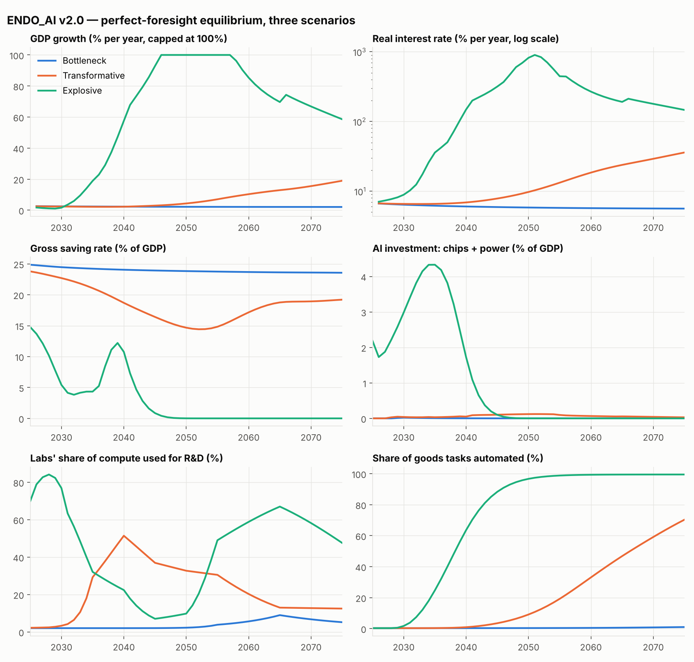
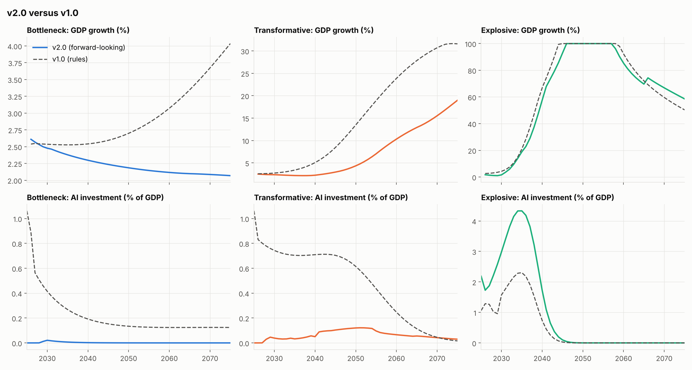
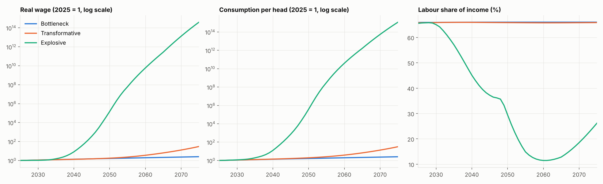
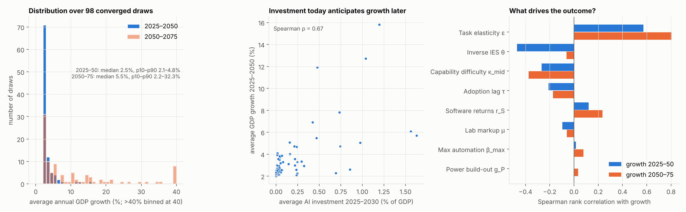

# ENDO_AI v2.0 — Perfect-foresight equilibrium with AI

**Version:** 2.0 (forward-looking agents, perfect foresight)
**Code:** [`../src/endo_ai_v2.py`](../src/endo_ai_v2.py) (model and solver), [`../src/run_v2.py`](../src/run_v2.py) (scenarios, figures, summary), [`../src/run_mc_v2.py`](../src/run_mc_v2.py) (Monte Carlo)
**Results:** [`../output/`](../output/)
**Previous version:** [v1.0](../../v1.0/doc/MODEL.md)

---

## Contents

1. [What is new in v2.0](#1-what-is-new-in-v20)
2. [Technology (unchanged from v1.0)](#2-technology-unchanged-from-v10)
3. [Agents and markets](#3-agents-and-markets)
   1. [Households](#31-households)
   2. [Goods firms](#32-goods-firms)
   3. [Compute owners: no-arbitrage with expected capital losses](#33-compute-owners-no-arbitrage-with-expected-capital-losses)
   4. [AI labs: pricing and the R&D decision](#34-ai-labs-pricing-and-the-rd-decision)
   5. [Physical capital](#35-physical-capital)
   6. [Market clearing](#36-market-clearing)
4. [Equilibrium definition](#4-equilibrium-definition)
5. [Solution algorithm](#5-solution-algorithm)
6. [Calibration](#6-calibration)
7. [Parameters](#7-parameters)
8. [Scenarios and Monte Carlo](#8-scenarios-and-monte-carlo)
9. [Results](#9-results)
10. [Interpretation](#10-interpretation)
11. [Limitations and roadmap](#11-limitations-and-roadmap)
12. [How to run](#12-how-to-run)
13. [References](#13-references)

---

## 1. What is new in v2.0

v1.0 closed the model with rules: a fixed saving rate, an exogenous path for
AI-lab spending, and an investment split based on *current* returns. v2.0
replaces all three with **forward-looking decisions under perfect foresight**:

| Decision | v1.0 (rules) | v2.0 (forward-looking) |
|---|---|---|
| Consumption and saving | Fixed saving rate $s = 0.25$ | Ramsey households; the interest rate path satisfies the Euler equation |
| Physical capital | Softmax on current returns | Firms demand $K$ until $MP_K - \delta_K = r$ (subject to construction limits) |
| AI hardware and power | Softmax on current returns, exogenous lab spending | No-arbitrage: rental of compute = user cost, including **expected capital losses** from falling chip prices |
| Lab R&D (training, AI research, experiments) | Fixed shares of compute, lab spending as an exogenous GDP share | Labs choose the R&D share of compute to **maximise the present value of their profits** |
| Price of AI services | Not modelled | Labs own the software and charge a markup $\mu$ over compute cost |
| Time | Continuous, $\Delta t = 0.1$ | Discrete, annual |

The main consequence: **AI investment now responds to expected returns.** If
households, compute owners and labs expect AI to become very productive, they
invest earlier and save differently. If they expect little, AI investment
collapses even when it would be valuable in hindsight.

---

## 2. Technology (unchanged from v1.0)

The production, automation and research blocks are those of
[v1.0](../../v1.0/doc/MODEL.md#3-model-structure), now in annual discrete time.
In brief, with $t$ = years since 2025:

**Goods production** (task-based CES nested in Cobb-Douglas):

$$
Y_t = A_t K_t^{\alpha} Z_t^{1-\alpha}, \qquad
Z_t = \Big[\tilde\beta_t^{1/\varepsilon} X_t^{\rho} + (1-\tilde\beta_t)^{1/\varepsilon} L_{Y,t}^{\rho}\Big]^{1/\rho},
\qquad \rho = \frac{\varepsilon - 1}{\varepsilon}.
$$

**AI input** is inference compute measured in worker-equivalents:

$$
X_t = \frac{S_t\ u^{inf}_t\ H_t}{c}, \qquad u^{inf}_t = 1 - u_{RA} - h_t ,
$$

where $h_t$ is the share of compute that labs devote to R&D. **This share is
now chosen by the labs** (Section 3.4). $u_{RA} = 0.10$ is a fixed share used for
general (publicly funded) research. Lab R&D compute is split in fixed
proportions: training $f_T = 0.6$, AI-software research $f_{RS} = 0.3$ and
experiments $f_{exp} = 0.1$. These match v1.0's shares of 0.30, 0.15 and 0.05
when $h = 0.5$.

**Capability and automation:**

$$
\mathcal{C}_{t+1} = \mathcal{C}_t + \frac{f_T h_t S_t H_t}{\bar C_T}, \qquad
\kappa_{t+1} = \ln \mathcal{C}_{t+1},
$$

$$
\tilde\beta_{t+1} = \tilde\beta_t + \frac{\max\big(\beta(\kappa_{t+1}) G_t,\ \beta_0\big) - \tilde\beta_t}{\tau}, \qquad
\tilde\beta_{R,t+1} = \tilde\beta_{R,t} + \frac{\beta_R(\kappa_{t+1}) - \tilde\beta_{R,t}}{\tau_R},
$$

with logistic capability curves $\beta(\kappa)$, $\beta_R(\kappa)$ as in v1.0. The
adoption gate $G_t$ compares the wage with the **price of an AI worker-equivalent**,
which is now the labs' price:

$$
G_t = \Big[1 + \exp\big(-\gamma_G \ln(w_t / p^{AI}_t)\big)\Big]^{-1}, \qquad
p^{AI}_t = \mu R_{H,t}\frac{c}{S_t}.
$$

**Research:**

$$
\frac{a_{t+1}}{a_t} = \exp\Big(\theta_A a_t^{\phi_A - 1} (R_{A,t}/R_{A,0})^{\lambda_A}\Big),
$$

$$
\ln S_{t+1} = \min\Big(\ln S_t + \theta_S S_t^{\phi_S - 1} \Big(\frac{R_{S,t}}{R_{S,0}}\Big)^{\lambda_S}
\Big(\frac{f_{exp} h_t H_t}{H_{exp,0}}\Big)^{\gamma}\Big(1 - \frac{\ln S_t}{\ln S_{\max}}\Big),\ \ln S_{\max}\Big),
$$

with $\phi_S = 1 - \lambda_S / r_S$. **Note the rename:** v1.0's returns to
software research $r$ are called $r_S$ in v2.0, because $r$ now denotes the
interest rate. $R_{A}$ and $R_{S}$ are CES aggregates of human and AI
researchers, exactly as in v1.0. AI researchers use compute $u_{RA} H$ and
$f_{RS} h H$ respectively.

**Power:** usable compute cannot exceed what installed power capacity can run,
$H_t \le \eta_t P_t$. Energy efficiency grows at $g_\eta$, and power capacity can
grow at most at rate $g_P$ per year:

$$
P_{t+1} \le (1-\delta_P) P_t e^{g_P}.
$$

**Chip price-performance:** $Q_{t+1} = Q_t e^{g_Q}(1 + I^{chip}_t/\mathcal{I}_t)^{b}$,
with learning-by-doing on cumulative chip spending $\mathcal{I}$.

---

## 3. Agents and markets

### 3.1 Households

A representative household of size $L_t$ (growth $n$) owns all firms, capital,
hardware and power capacity. It chooses consumption per head $c_t$ to maximise

$$
\sum_{t=0}^{\infty} \beta^t L_t \frac{c_t^{1-\theta}}{1-\theta}, \qquad \beta = \frac{1}{1+\rho_{disc}}.
$$

The first-order condition is the **Euler equation**:

$$
1 + r_{t+1} = \frac{1}{\beta}\Big(\frac{c_{t+1}}{c_t}\Big)^{\theta}.
$$

With $\theta = 1.5$ and $\rho_{disc} = 0.03$, consumption growth of 2 % per year
implies $r \approx 0.06$. Growth of 30 % implies $r \approx 0.52$. **Expected
fast growth therefore raises interest rates before it happens**: households
want to borrow against their richer future, so they save less today.

### 3.2 Goods firms

Goods firms are competitive. They hire labour at wage $w$, rent capital, and
buy AI services at price $MP_X$ per worker-equivalent:

$$
w_t = (1-\alpha) Y_t \frac{(1-\tilde\beta_t)^{1/\varepsilon} L_{Y,t}^{\rho-1}}{B_t}, \qquad
MP_{X,t} = (1-\alpha) Y_t \frac{\tilde\beta_t^{1/\varepsilon} X_t^{\rho-1}}{B_t}, \qquad
MP_{K,t} = \alpha\frac{Y_t}{K_t},
$$

with $B_t = \tilde\beta_t^{1/\varepsilon} X_t^{\rho} + (1-\tilde\beta_t)^{1/\varepsilon} L_{Y,t}^{\rho}$.

### 3.3 Compute owners: no-arbitrage with expected capital losses

Competitive compute owners buy chips and power and rent usable compute to labs
at rental rate $R_{H,t}$. The price of one unit of new usable compute is

$$
\pi_t = \frac{1}{Q_t} + \frac{p_P}{\eta_t}
$$

(chip plus the power capacity to run it). Holding one unit from $t$ to $t+1$
earns the rental, and the chip and power are then worth their replacement
values. **No-arbitrage** requires

$$
R_{H,t+1} = UC_{t+1} \equiv (1 + r_{t+1}) \pi_t - (1-\delta_H)\frac{1}{Q_{t+1}} - (1-\delta_P)\frac{p_P}{\eta_t}
$$

whenever investment is positive and the power limit does not bind.

**Why this matters:** chip prices fall about 25 % per year ($g_Q$), so a chip
bought today loses much of its value to cheaper successors. The user cost
therefore contains a large **expected capital loss**:
$UC \approx \pi(r + \delta_H + g_Q)$. Investors only buy compute now if the
expected rental covers it. This gives an incentive to **wait**, which v1.0
could not capture.

Two constraints bound compute investment:

* **Irreversibility:** $H_{t+1} \ge (1-\delta_H) H_t$.
* **Power build-out:** $H_{t+1} \le \eta_{t+1}(1-\delta_P)P_t e^{g_P}$. When this
  binds, $R_{H} > UC$ and the difference is a scarcity rent earned by power
  owners.

### 3.4 AI labs: pricing and the R&D decision

AI labs own the software $S$ and the capability stock. They rent all
non-public compute, $(1-u_{RA})H_t$, at rate $R_{H,t}$, and sell AI services
to goods firms.

**Static pricing.** Labs set the price of AI services as a markup $\mu$ over
the compute cost of an inference worker-equivalent. Goods firms pay $MP_X$, so
the inference first-order condition is

$$
MP_{X,t}\frac{S_t}{c} = \mu R_{H,t}.
$$

Together with the no-arbitrage condition, this determines the demand for
compute and hence $H_{t+1}$. Lab profits are

$$
\Pi_t = MP_{X,t} X_t - R_{H,t}(1-u_{RA}) H_t
      = R_{H,t} H_t \big[\mu(1 - u_{RA} - h_t) - (1 - u_{RA})\big].
$$

Every unit of compute spent on R&D instead of inference lowers profits today.
With $\mu = 2$, current profits are negative once $h_t > 0.45$.

**Dynamic R&D decision.** Labs choose the path of R&D shares
$h = (h_0, h_1, \dots)$ to maximise the present value of profits, taking the
equilibrium interest-rate and chip-price paths as given:

$$
\max_{h}\ V(h) = \sum_{t=0}^{T_L} D_t \Pi_t(h), \qquad
D_t = \prod_{s=1}^{t}\frac{1}{1+r_s}, \qquad h_t \in [0.02,\ 0.85].
$$

R&D raises future profits in three ways:

* through capability $\kappa$, which raises automation $\tilde\beta$ and so the
  demand for AI services;
* through software efficiency $S$, which raises the number of worker-equivalents
  per unit of compute;
* through automated research, which feeds back into $S$.

The labs act as the representative AI sector. They take prices as given, but
they understand how their R&D changes the demand for their services along the
equilibrium path.

**Policy representation.** For tractability, $h_t$ is parameterised in logit
space by 11 knots at $t \in$ (0, 3, 6, 10, 15, 20, 25, 30, 40, 50, 75). It is
linear between knots and constant after the last one:

$$
h_t = h_{lo} + \frac{h_{hi} - h_{lo}}{1 + e^{-z(t)}}, \qquad
z(t) = \text{piecewise linear through } z_0, \dots, z_{10} .
$$

The lab objective runs to $T_L$ = 2100, 25 years before the end of the
simulation, so that the terminal period does not distort R&D decisions.

### 3.5 Physical capital

Firms demand capital until its net marginal product equals the interest rate:

$$
K^{\ast}_{t+1} = \left(\frac{\alpha A_{t+1} Z_{t+1}^{1-\alpha}}{r_{t+1} + \delta_K}\right)^{1/(1-\alpha)} .
$$

Actual capital stays between irreversibility and the construction limit,
$(1-\delta_K)K_t \le K_{t+1} \le K_t e^{g_K^{\max}}$.

### 3.6 Market clearing

Goods are used for consumption and three kinds of investment:

$$
Y_t = C_t + \underbrace{K_{t+1} - (1-\delta_K)K_t}_{I^K_t}
+ \underbrace{\frac{H_{t+1} - (1-\delta_H)H_t}{Q_t}}_{I^{chip}_t}
+ \underbrace{p_P\big(P_{t+1} - (1-\delta_P)P_t\big)}_{I^P_t}.
$$

**AI investment** is $I^{chip}_t + I^P_t$. The saving rate is
$1 - C_t / Y_t$. Lab profits, compute rents and power scarcity rents are paid
to households as owners, so they do not appear separately in the resource
constraint.

---

## 4. Equilibrium definition

Given initial states in 2025, a **perfect-foresight equilibrium** is a set of
paths for

* prices $r_t$, $w_t$, $R_{H,t}$ and $MP_{X,t}$;
* allocations $C_t$, $K_t$, $H_t$, $P_t$ and $h_t$;
* technology states $S_t$, $a_t$, $\tilde\beta_t$, $\tilde\beta_{R,t}$, $\mathcal{C}_t$ and $Q_t$;

such that:

1. households' consumption satisfies the Euler equation (3.1);
2. capital demand satisfies (3.5);
3. compute investment satisfies no-arbitrage or the binding constraint (3.3);
4. labs price at the markup and choose $h$ to maximise $V(h)$ given prices (3.4);
5. the goods market clears (3.6);
6. technology evolves as in Section 2;
7. expectations are correct: the price paths agents use are those the
   equilibrium generates.

---

## 5. Solution algorithm

The horizon is $T = 100$ years (2025–2125). Results are reported to 2075, so
the terminal condition has little influence. Every array carries a "draw"
dimension, so scenarios and Monte Carlo draws are solved simultaneously.

**Forward simulation.** Given an interest-rate path $r$, an R&D policy $h$ and
an expected chip-price path, the model is simulated forward. Each year it:

1. computes output, factor prices and lab profits;
2. updates research and capability;
3. finds next year's compute stock $H_{t+1}$ by bisection on
   $\ln(MP_X S/(c\mu)) - \ln UC = 0$, with $K_{t+1}(H_{t+1})$ from (3.5) solved
   simultaneously;
4. applies the bounds smoothly (see below);
5. obtains consumption from the resource constraint.

**Inner loop — Newton on interest rates.** The unknowns are $x_t = \ln(1 + r_t)$
for $t = 1..T$. The residuals are

$$
F_t(x) = \ln\Big(\frac{1}{\beta}\Big(\frac{c_{t+1}(x)}{c_t(x)}\Big)^{\theta}\Big) - x_{t+1}.
$$

The full $T \times T$ Jacobian is computed by forward differences: all $T$
perturbed paths of all draws run as one vectorised simulation. Newton steps
use a vectorised line search over (1, 0.5, 0.25, 0.1, 0.03). Convergence
typically takes 3–25 iterations, to a maximum Euler gap below $10^{-6}$ (last
decade excluded).

*A simple Fair–Taylor iteration does not converge here*: capital demand reacts
so strongly to the interest rate that the iteration oscillates between saving
rates of 0 and 1. Newton's method is necessary.

**Outer loop — lab policy.** Given the price path, labs maximise $V$ over the
11 knot values. They use central-difference gradients, a unit max-norm
direction, and a vectorised line search that only accepts improvements. The
outer fixed point between prices and lab policy is **damped**:
$z \leftarrow z + \omega (z^{BR} - z)$, with $\omega$ falling from 0.5 to 0.15.
It stops when the R&D share changes by less than 0.01 (to 2075) between rounds.

**Smooth bounds.** The irreversibility, power and construction limits are
imposed with a smooth clip in logs (sharpness 25), and consumption has a smooth
floor at 2 % of output. This keeps the residuals differentiable for Newton.
With hard bounds, Newton stalled exactly at the points where a constraint
switches on.

**Diagnostics.** These are reported in `output/summary.txt`:

* the maximum Euler gap;
* the last change in the lab policy;
* for the Monte Carlo, a convergence flag per draw.

A check of the solved scenarios gives:

| Condition | Accuracy |
|---|---|
| Euler equation, to 2075 | max gap $6 \times 10^{-7}$ |
| Resource constraint | exact (relative error $2 \times 10^{-16}$) |
| Compute no-arbitrage, in years where no constraint is close to binding | within 1 % (Bottleneck), within 4 % (Transformative) |

The small no-arbitrage gap comes from the smooth bounds and from using the
previous iteration's chip-price path as the expected path.

---

## 6. Calibration

The technology parameters are those of v1.0. New calibration steps:

* **Preferences:** $\theta = 1.5$ and $\rho_{disc} = 0.03$. Together they imply
  $r \approx 0.065$ at 2.5 % growth, close to the 2025 net return on capital
  ($\alpha Y/K - \delta_K = 0.067$).
* **Compute per AI worker-equivalent $c$:** set so that **in 2025 the rental
  value of compute equals its user cost** at $r_0 = 0.05$, with the v1.0 R&D
  share $h_0 = 0.5$. In other words, the 2025 compute stock is an equilibrium
  stock under v1-style allocation. $A_0$ then makes $Y_0 = 100$.
* **Markup:** $\mu = 2$, a 50 % gross margin on AI services.
* **Power:** 2025 capacity can run twice the 2025 chip stock. Power and
  datacentre capacity costs half as much as chips per FLOP/s.

The labs re-optimise $h$ immediately from 2025, so 2025 is in general *not* a
steady state. The initial jump in AI investment is part of the result.

---

## 7. Parameters

Technology parameters and their defaults are documented in
[v1.0, Section 6](../../v1.0/doc/MODEL.md#6-parameter-table). Changes and
additions in v2.0:

| Parameter | Code | Default | Meaning |
|---|---|---|---|
| $\theta$ | `theta` | 1.5 | CRRA (inverse elasticity of intertemporal substitution) |
| $\rho_{disc}$ | `rho_disc` | 0.03 | Pure rate of time preference |
| $\mu$ | `mu` | 2.0 | Markup of AI labs on AI services |
| $r_S$ | `r_S` | 1.0 | Returns to software research (was `r` in v1.0) |
| $u_{RA}$ | `u_RA` | 0.10 | Compute share for general (public) research |
| $f_T, f_{RS}, f_{exp}$ | `f_T`, `f_RS`, `f_exp` | 0.6, 0.3, 0.1 | Split of lab R&D compute |
| $h_0$ | `h0` | 0.5 | Initial guess for the lab R&D share; also used in calibration |
| $h_{lo}, h_{hi}$ | `H_LO`, `H_HI` | 0.02, 0.85 | Bounds on the lab R&D share |
| $T$ | `T` | 100 | Horizon (years) |
| $r_0$ | `r0` | 0.05 | Interest rate used in the 2025 calibration |
| — | `m0`, `m_max`, `s`, `zeta`, ... | removed | v1.0 behavioural rules, now endogenous |

---

## 8. Scenarios and Monte Carlo

The three scenarios use the same technology parameters as v1.0. The lab
spending path $m_{\max}$ is no longer a parameter, because it is endogenous.

| Parameter | Bottleneck | Transformative | Explosive |
|---|---|---|---|
| $\varepsilon$ | 0.4 | 0.6 | 0.8 |
| $r_S$ | 0.7 | 1.0 | 1.4 |
| $\beta_{\max}$ | 0.70 | 0.95 | 0.995 |
| $\beta_{R,\max}$ | 0.60 | 0.95 | 0.995 |
| $\bar\kappa$ | 16 | 12 | 9 |
| $\tau$ | 12 | 7 | 4 |
| $g_P$ | 0.08 | 0.15 | 0.30 |

**Monte Carlo:** 100 draws (seed 7) from independent uniform distributions.
The v2.0 equilibrium is much more expensive to compute than a v1.0 run, so
there are fewer draws than in v1.0.

| Parameter | Range |
|---|---|
| $\varepsilon$ | [0.30, 0.95] |
| $r_S$ | [0.5, 1.5] |
| $\beta_{\max} = \beta_{R,\max}$ | [0.60, 0.995] |
| $\tau$ | [3, 15] |
| $g_P$ | [0.05, 0.30] |
| $\bar\kappa$ | [8, 18] |
| $\theta$ | [1.0, 2.5] |
| $\mu$ | [1.5, 3.0] |

A draw counts as converged if its Euler gap is below $10^{-4}$ and its lab
policy changed by less than 0.05 in the last outer round. Only converged draws
enter the statistics.

---

## 9. Results

All numbers come from [`../output/summary.txt`](../output/summary.txt).

### 9.1 Equilibrium paths



| | Bottleneck | Transformative | Explosive |
|---|---|---|---|
| GDP growth 2030 / 2040 / 2050 | 2.5 / 2.3 / 2.2 % | 2.4 / 2.2 / 4.3 % | 1.6 / 58 / 146 % |
| Average growth 2025–2050 | 2.3 % | 2.6 % | 51 % |
| Interest rate 2030 / 2040 / 2050 | 6.4 / 6.0 / 5.8 % | 6.6 / 6.9 / 9.7 % | 8.9 / 149 / 820 % |
| Saving rate 2025 / 2035 / 2050 | 24.9 / 24.2 / 23.8 % | 23.8 / 21.1 / 14.7 % | 14.8 / 4.3 / 0.0 % |
| Peak AI investment (% of GDP) | 0.02 % (2030) | 0.12 % (2051) | 4.3 % (2035) |
| Lab R&D share 2025 / 2035 / 2050 | 2 / 2 / 2 % | 2 / 29 / 33 % | 70 / 32 / 10 % |
| Tasks automated 2050 | 0 % | 9 % | 97 % |
| Wage index 2050 (2025 = 1) | 1.6 | 1.8 | $1.5 \times 10^5$ |
| Labour share 2050 | 66 % | 66 % | 29 % |

### 9.2 Comparison with v1.0



| Average growth 2025–2050 | v1.0 (rules) | v2.0 (forward-looking) |
|---|---|---|
| Bottleneck | 2.6 % | 2.3 % |
| Transformative | 5.5 % | 2.6 % |
| Explosive | 57 % | 51 % |

### 9.3 Wages, consumption and the labour share



### 9.4 Monte Carlo



98 of the 100 draws converged.

* **Average growth 2025–2050:** median 2.5 % per year; 5th–95th percentile
  2.1 %–6.2 %. Only 3 % of draws average more than 10 % per year (v1.0: 11 %).
* **Average growth 2050–2075:** median 5.5 %; 5th–95th percentile 2.1 %–50 %.
* **AI investment 2025–2030:** median 0.02 % of GDP, 95th percentile 0.87 %.
  The rank correlation between early AI investment and later growth is
  **0.67**, so investment today anticipates growth later.

Spearman rank correlation of each parameter with average growth:

| Parameter | 2025–50 | 2050–75 |
|---|---|---|
| Task elasticity $\varepsilon$ | +0.57 | +0.80 |
| Inverse IES $\theta$ | −0.47 | −0.06 |
| Capability difficulty $\bar\kappa$ | −0.27 | −0.37 |
| Adoption lag $\tau$ | −0.21 | −0.17 |
| Software returns $r_S$ | +0.12 | +0.23 |
| Lab markup $\mu$ | −0.09 | −0.06 |
| Max automation $\beta_{\max}$ | +0.02 | +0.08 |
| Power build-out $g_P$ | +0.00 | +0.03 |

---

## 10. Interpretation

1. **AI investment is driven by expectations, and it is bimodal.** When the
   expected payoff from capability is high (Explosive), labs spend 70–85 % of
   their compute on R&D from the start, and AI investment rises to over 4 % of
   GDP within a decade, twice the v1.0 rule. When the payoff is modest
   (Bottleneck), labs cut R&D to the minimum and AI investment almost
   disappears. v1.0's fixed lab-spending rule hid this: it kept investing
   regardless of prospects.

2. **Falling chip prices create an incentive to wait.** In the Transformative
   scenario, labs keep R&D near the minimum until the early 2030s and then raise
   it to about 50 % by 2040. Compute bought later is cheaper, and the payoff
   from capability (automation) only arrives once capability is close to the
   threshold. As a result, takeoff is about a decade later than in v1.0, and
   average growth to 2050 is 2.6 % instead of 5.5 %.

3. **Private R&D is limited by appropriability.** Labs only capture the
   markup on AI services. They do not capture the gains to workers (higher
   wages), to capital owners, or from general TFP spillovers. They therefore
   invest less in capability than a planner would. The Transformative delay is
   partly this underinvestment. A natural v2.x extension is to compute the
   planner solution and measure the gap.

4. **Interest rates rise before growth does.** Households anticipate higher
   future consumption and want to borrow against it. The interest rate rises
   *ahead of* the growth acceleration: in the Explosive scenario it is already
   9 % in 2030, when growth is still 1.6 %. In 2025 the saving rate is already
   15 % instead of 25 %. This matches the argument of Chow, Halperin & Mazlish
   (2024) that real interest rates are a market signal of expected
   transformative AI.

5. **The saving rate falls in anticipation of riches.** In the Transformative
   scenario, the saving rate declines from 24 % to 15 % by 2050. In the
   Explosive scenario it goes to zero, because households expect to be vastly
   richer.

6. **The Baumol result from v1.0 survives.** With $\varepsilon < 1$, the labour
   share stays at about 66 % unless almost all tasks are automated *and*
   $\varepsilon$ is high.

7. **Preferences now matter for growth.** In the Monte Carlo, $\theta$ is the
   second most important driver of growth to 2050 (rank correlation −0.47).
   It had no role in v1.0. When households strongly prefer smooth consumption,
   expected AI growth raises interest rates sharply. That lowers the present
   value of future lab profits, so labs do less R&D, and takeoff is delayed.
   Capability difficulty $\bar\kappa$ matters less than in v1.0, because
   forward-looking labs simply wait when capability is far away. Power
   build-out barely matters, because few draws reach the power limit before 2050.

8. **Growth is lower and less dispersed than in v1.0.** The median average
   growth rate to 2050 is 2.5 % (v1.0: 4.2 %). The 95th percentile is 6.2 %
   (v1.0: 14.6 %). With forward-looking agents, the high-growth outcomes need
   high $\varepsilon$ *and* low $\theta$ *and* reachable capabilities at the
   same time.

9. **Explosive levels remain unrealistic.** As in v1.0, once growth exceeds
   about 100 % per year, the remaining constraints (power, construction,
   software ceiling) are too loose. Interest rates of several hundred percent
   follow mechanically from the Euler equation. Use the Explosive scenario for
   timing and direction, not for levels.

---

## 11. Limitations and roadmap

* **Perfect foresight.** There is no uncertainty about AI progress, so there is
  no option value beyond the deterministic incentive to wait, no risk premia,
  and no precautionary saving. Uncertainty about whether takeoff happens is
  arguably the defining feature of the real situation.
* **One representative lab, fixed markup.** There is no competition for market
  share, no patent races and no entry. The markup is exogenous.
* **Lab policy is parameterised** by 11 knots. The optimum within this family is
  found, but finer timing is smoothed out, and the kinks in the R&D-share paths
  come from the knots.
* **The lab's horizon ends in 2100**, and the terminal condition in 2125 is
  simple: the interest rate is held constant at the end.
* **Automation adoption is not forward-looking.** It still uses the lagged cost
  gate.
* **General research is publicly funded** at a fixed compute share and does not
  respond to returns.
* **Explosive regimes are under-constrained**, as in v1.0.
* **Calibration.** The 2025 compute stock is consistent with no-arbitrage only at
  v1.0's R&D share. Actual 2025 AI investment (around 0.5–1 % of world GDP) lies
  between the Transformative and Explosive equilibria. Within this model,
  today's investment levels are consistent only with fairly optimistic
  expectations.

**Roadmap:**

* **v2.1:** planner solution and the gap to the decentralised equilibrium;
  endogenous markup with $n$ labs (Cournot).
* **v3.0:** aggregate uncertainty about capability arrival (regime switching),
  with risk premia and option value.
* **v3.x:** distribution (workers vs capital owners), policy experiments (compute
  taxes, R&D subsidies, UBI), open economy.

---

## 12. How to run

```bash
cd v2.0
pip install -r requirements.txt
python src/run_mc_v2.py 100      # Monte Carlo, ~15 min on 2 cores, writes output/mc_cache.pkl
python src/run_v2.py             # scenarios (~5 min), figures, CSVs, summary
python src/run_v2.py --resolve   # force re-solving the scenarios instead of using the cache
```

To use the model directly:

```python
from endo_ai_v2 import make_params, solve_equilibrium, SCENARIOS
P = make_params(1, **SCENARIOS["Transformative"])
o = solve_equilibrium(P)          # dict of (N, T+1) arrays: Y, g, r, C, save_rate, h, ...
```

---

## 13. References

* Acemoglu, D. & Restrepo, P. (2018). The race between man and machine. *American Economic Review* 108(6).
* Aghion, P., Jones, B. F. & Jones, C. I. (2019). Artificial intelligence and economic growth. In *The Economics of Artificial Intelligence*, NBER.
* Chow, T., Halperin, B. & Mazlish, J. Z. (2024). Transformative AI, existential risk, and real interest rates. Working paper.
* Davidson, T. (2021). Could advanced AI drive explosive economic growth? Open Philanthropy.
* Fair, R. C. & Taylor, J. B. (1983). Solution and maximum likelihood estimation of dynamic nonlinear rational expectations models. *Econometrica* 51(4).
* Jones, C. I. (1995). R&D-based models of economic growth. *Journal of Political Economy* 103(4).
* Korinek, A. & Suh, D. (2024). Scenarios for the transition to AGI. NBER Working Paper 32255.
* Ramsey, F. P. (1928). A mathematical theory of saving. *Economic Journal* 38(152).
* Romer, P. (1990). Endogenous technological change. *Journal of Political Economy* 98(5).
* Trammell, P. & Korinek, A. (2023). Economic growth under transformative AI. NBER Working Paper 31815.
